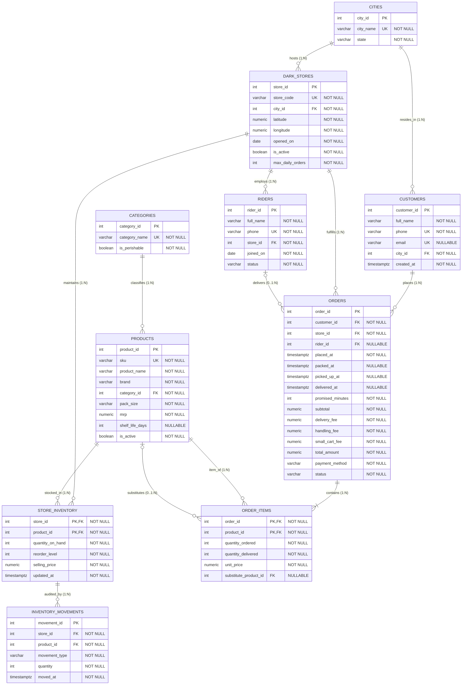

# Blinkit 10-Minute Grocery Delivery Database: Schema Design & Normalization Report

**Project Phase:** CP1 — Schema & Normalization  
**Database System:** PostgreSQL 15+  
**Target Schema:** `blinkit`  
**Deliverable Document:** `docs/02_schema_design.md`

---

## 1. Executive Summary & Design Principles

This document presents the relational schema design, functional dependency analysis, normalization proofs, and data integrity verification for the **Blinkit 10-Minute Grocery Delivery Database**. The schema has been reverse-engineered from raw production data exports (`seed_data/`, comprising 10 CSV files and 675,000 order item lines) to support 30 core production workload queries (`queries/workload_30.sql`).

### Core Design Rules Applied:
1. **Namespace Encapsulation:** All database objects reside within the dedicated PostgreSQL schema `blinkit`.
2. **Exact Header Preservation:** Table names and column names strictly mirror the CSV filenames and headers to ensure 100% interoperability with the application workload without modifying query files.
3. **Rigorous Relational Integrity:** Explicit primary keys, composite keys, and foreign keys with justified referential actions (`RESTRICT`, `CASCADE`, `SET NULL`).
4. **Natural Candidate Keys & Domain Restrictions:** Natural keys (phone numbers, store codes, SKUs, category names, city names) are enforced with `UNIQUE` constraints and format `CHECK` expressions.
5. **No Artificial Tuning Indexes in CP1:** Per project specification, only natural backing indexes created automatically by PostgreSQL for `PRIMARY KEY` and `UNIQUE` constraints exist in this baseline phase. No secondary B-Tree, GIN, BRIN, or partial indexes have been added.
6. **Zero-Error Data Ingestion:** All 10 CSV files load cleanly via PostgreSQL `\copy` in topological dependency order without data loss or truncation.

---

## 2. Complete Data Dictionary

### Table 1: `cities`
- **Description:** Geographical metropolitan areas in India where Blinkit operates dark stores and serves customers.
- **Row Count:** 10 rows

| Column Name | Data Type | Nullable | Constraints & Defaults | Business & Technical Justification |
| :--- | :--- | :--- | :--- | :--- |
| `city_id` | `INT` | `NOT NULL` | `PRIMARY KEY` | Unique surrogate identifier for each metropolitan operating zone. |
| `city_name` | `VARCHAR(50)` | `NOT NULL` | `UNIQUE` | City name (e.g., Bengaluru, Mumbai, Delhi). Unique to prevent duplicate operational entries. |
| `state` | `VARCHAR(50)` | `NOT NULL` | — | Indian state / union territory governing the city (e.g., Karnataka, Maharashtra). |

---

### Table 2: `dark_stores`
- **Description:** Hyper-local micro-fulfillment centers (warehouses) holding physical inventory within a ~3 km delivery radius.
- **Row Count:** 120 rows

| Column Name | Data Type | Nullable | Constraints & Defaults | Business & Technical Justification |
| :--- | :--- | :--- | :--- | :--- |
| `store_id` | `INT` | `NOT NULL` | `PRIMARY KEY` | Unique integer primary key identifying each dark store. |
| `store_code` | `VARCHAR(20)` | `NOT NULL` | `UNIQUE`, `CHECK (~ '^[A-Z]{3}-[A-Z]{3}-[0-9]{2}$')` | Human-readable standardized store code (e.g., `MUM-AND-11`). Unique and constrained to standard format. |
| `city_id` | `INT` | `NOT NULL` | `REFERENCES cities(city_id) ON DELETE RESTRICT` | Foreign key linking store to city. Deleting an active city with dark stores is restricted. |
| `latitude` | `NUMERIC(9,6)` | `NOT NULL` | `CHECK (BETWEEN -90.0 AND 90.0)` | Exact GPS latitude coordinate for haversine distance routing. 6 decimal places yields ~0.11 m precision. |
| `longitude` | `NUMERIC(9,6)` | `NOT NULL` | `CHECK (BETWEEN -180.0 AND 180.0)` | Exact GPS longitude coordinate for geographical store assignment. |
| `opened_on` | `DATE` | `NOT NULL` | — | Calendar date the micro-warehouse was commissioned. |
| `is_active` | `BOOLEAN` | `NOT NULL` | `DEFAULT TRUE` | Operational status flag. Closed or decommissioned stores are flagged `FALSE`. |
| `max_daily_orders` | `INT` | `NOT NULL` | `CHECK (> 0)` | Maximum throughput capacity per day (ranging 1,500 to 3,000 in seed data) to prevent order overload. |

---

### Table 3: `categories`
- **Description:** High-level departmental taxonomy for products.
- **Row Count:** 12 rows

| Column Name | Data Type | Nullable | Constraints & Defaults | Business & Technical Justification |
| :--- | :--- | :--- | :--- | :--- |
| `category_id` | `INT` | `NOT NULL` | `PRIMARY KEY` | Unique identifier for product departments. |
| `category_name` | `VARCHAR(50)` | `NOT NULL` | `UNIQUE` | Taxonomy label (e.g., 'Dairy', 'Fruits & Vegetables', 'Bakery'). Must be unique. |
| `is_perishable` | `BOOLEAN` | `NOT NULL` | — | Flag indicating temperature-sensitive products requiring cold chain and shelf-life tracking. |

---

### Table 4: `products`
- **Description:** Global master product catalog containing descriptions, brands, packaging, and maximum retail prices.
- **Row Count:** 1,500 rows

| Column Name | Data Type | Nullable | Constraints & Defaults | Business & Technical Justification |
| :--- | :--- | :--- | :--- | :--- |
| `product_id` | `INT` | `NOT NULL` | `PRIMARY KEY` | Master catalog surrogate key. |
| `sku` | `VARCHAR(20)` | `NOT NULL` | `UNIQUE`, `CHECK (~ '^BK[0-9]{8}$')` | Blinkit Stock Keeping Unit barcode handle (e.g., `BK10007919`). Enforces 8-digit catalog syntax. |
| `product_name` | `VARCHAR(150)` | `NOT NULL` | — | Full commercial product title. |
| `brand` | `VARCHAR(100)` | `NOT NULL` | — | Manufacturing or distributor brand (e.g., Amul, Vim, Tata Sampann). |
| `category_id` | `INT` | `NOT NULL` | `REFERENCES categories(category_id) ON DELETE RESTRICT` | Foreign key to `categories`. Restricts deletion of categories containing active products. |
| `pack_size` | `VARCHAR(50)` | `NOT NULL` | — | Physical quantity unit (e.g., '500 ml', '1 kg', '4 pcs'). |
| `mrp` | `NUMERIC(10,2)` | `NOT NULL` | `CHECK (> 0)` | Maximum Retail Price in Indian Rupees. Must be strictly positive. |
| `shelf_life_days` | `INT` | `NULLABLE` | `CHECK (IS NULL OR > 0)` | Expiry threshold in days. Nullable because non-perishables (detergents, utensils) do not expire. |
| `is_active` | `BOOLEAN` | `NOT NULL` | `DEFAULT TRUE` | Catalog visibility flag. Inactive products are hidden from search and recommendations. |

---

### Table 5: `store_inventory`
- **Description:** Store-level localized stock levels, reorder thresholds, and active selling prices.
- **Row Count:** 126,000 rows

| Column Name | Data Type | Nullable | Constraints & Defaults | Business & Technical Justification |
| :--- | :--- | :--- | :--- | :--- |
| `store_id` | `INT` | `NOT NULL` | `PRIMARY KEY (Part 1)`, `REFERENCES dark_stores(store_id) ON DELETE RESTRICT` | Composite key component identifying the holding micro-warehouse. |
| `product_id` | `INT` | `NOT NULL` | `PRIMARY KEY (Part 2)`, `REFERENCES products(product_id) ON DELETE RESTRICT` | Composite key component identifying the stocked catalog item. |
| `quantity_on_hand` | `INT` | `NOT NULL` | `DEFAULT 0`, `CHECK (>= 0)` | Real-time physical inventory available for picking. Cannot be negative. |
| `reorder_level` | `INT` | `NOT NULL` | `DEFAULT 0`, `CHECK (>= 0)` | Inventory reorder trigger point. When stock drops below this, replenishment alerts fire. |
| `selling_price` | `NUMERIC(10,2)` | `NOT NULL` | `CHECK (> 0)` | Store-specific retail price charged to customers. May discount from MRP. |
| `updated_at` | `TIMESTAMPTZ` | `NOT NULL` | `DEFAULT CURRENT_TIMESTAMP` | Audit timestamp tracking stock and price updates. |

---

### Table 6: `customers`
- **Description:** End-user consumers registered on the Blinkit platform.
- **Row Count:** 40,000 rows

| Column Name | Data Type | Nullable | Constraints & Defaults | Business & Technical Justification |
| :--- | :--- | :--- | :--- | :--- |
| `customer_id` | `INT` | `NOT NULL` | `PRIMARY KEY` | Surrogate customer identifier. |
| `full_name` | `VARCHAR(100)` | `NOT NULL` | — | Customer full legal name. |
| `phone` | `VARCHAR(15)` | `NOT NULL` | `UNIQUE`, `CHECK (~ '^[0-9]{10}$')` | 10-digit Indian mobile number. Primary login identifier; strictly unique. |
| `email` | `VARCHAR(150)` | `NULLABLE` | `UNIQUE`, `CHECK (IS NULL OR ~ '^[A-Za-z0-9._%+-]+@[A-Za-z0-9.-]+\.[A-Za-z]{2,}$')` | Optional customer email address. Unique when provided (45.06% null in seed data). |
| `city_id` | `INT` | `NOT NULL` | `REFERENCES cities(city_id) ON DELETE RESTRICT` | Default home city of customer. |
| `created_at` | `TIMESTAMPTZ` | `NOT NULL` | `DEFAULT CURRENT_TIMESTAMP` | Account creation timestamp used for customer cohort analysis (R16). |

---

### Table 7: `riders`
- **Description:** Dedicated delivery fleet partners stationed at dark stores.
- **Row Count:** 1,800 rows

| Column Name | Data Type | Nullable | Constraints & Defaults | Business & Technical Justification |
| :--- | :--- | :--- | :--- | :--- |
| `rider_id` | `INT` | `NOT NULL` | `PRIMARY KEY` | Unique delivery rider identifier. |
| `full_name` | `VARCHAR(100)` | `NOT NULL` | — | Rider's full name. |
| `phone` | `VARCHAR(15)` | `NOT NULL` | `UNIQUE`, `CHECK (~ '^[0-9]{10}$')` | 10-digit mobile number for dispatch contact; strictly unique. |
| `store_id` | `INT` | `NOT NULL` | `REFERENCES dark_stores(store_id) ON DELETE RESTRICT` | Operating dark store to which the rider is dedicated. |
| `joined_on` | `DATE` | `NOT NULL` | — | Date the rider onboarded with Blinkit. |
| `status` | `VARCHAR(20)` | `NOT NULL` | `DEFAULT 'ACTIVE'`, `CHECK (IN ('ACTIVE', 'ON_LEAVE', 'EXITED'))` | Fleet operational status controlling order dispatch availability (W03, R21). |

---

### Table 8: `orders`
- **Description:** Customer order headers capturing fulfillment milestones, billing fees, and payment status.
- **Row Count:** 150,000 rows

| Column Name | Data Type | Nullable | Constraints & Defaults | Business & Technical Justification |
| :--- | :--- | :--- | :--- | :--- |
| `order_id` | `INT` | `NOT NULL` | `PRIMARY KEY` | Unique order identifier. |
| `customer_id` | `INT` | `NOT NULL` | `REFERENCES customers(customer_id) ON DELETE RESTRICT` | Purchasing customer. Historic order records cannot be orphaned. |
| `store_id` | `INT` | `NOT NULL` | `REFERENCES dark_stores(store_id) ON DELETE RESTRICT` | Fulfilling dark store micro-warehouse. |
| `rider_id` | `INT` | `NULLABLE` | `REFERENCES riders(rider_id) ON DELETE SET NULL` | Assigned delivery partner. Null until dispatch (status `OUT_FOR_DELIVERY` or `DELIVERED`). |
| `placed_at` | `TIMESTAMPTZ` | `NOT NULL` | — | Order placement timestamp. Base reference for 10-minute SLA countdown. |
| `packed_at` | `TIMESTAMPTZ` | `NULLABLE` | `CHECK (IS NULL OR >= placed_at)` | Timestamp when warehouse picker finishes bagging goods. Null for `PLACED` orders. |
| `picked_up_at`| `TIMESTAMPTZ` | `NULLABLE` | `CHECK (IS NULL OR packed_at IS NULL OR >= packed_at)` | Timestamp when rider collects order from store. Null until dispatch. |
| `delivered_at`| `TIMESTAMPTZ` | `NULLABLE` | `CHECK (IS NULL OR picked_up_at IS NULL OR >= picked_up_at)` | Timestamp of delivery to customer doorstep. Null for active/cancelled orders. |
| `promised_minutes` | `INT` | `NOT NULL` | `DEFAULT 10`, `CHECK (> 0)` | Service delivery guarantee (10 min). Defaults to 10 for quick-commerce inserts (W01). |
| `subtotal` | `NUMERIC(10,2)` | `NOT NULL` | `CHECK (>= 0)` | Billed sum of delivered items ($\sum \text{delivered} \times \text{unit\_price}$). |
| `delivery_fee` | `NUMERIC(10,2)`| `NOT NULL` | `DEFAULT 0.00`, `CHECK (>= 0)` | Shipping charge (₹25 if subtotal < ₹199; ₹0 otherwise). |
| `handling_fee` | `NUMERIC(10,2)`| `NOT NULL` | `DEFAULT 0.00`, `CHECK (>= 0)` | Platform fulfillment surcharge (₹6 if subtotal < ₹500; ₹2 otherwise). |
| `small_cart_fee` | `NUMERIC(10,2)`| `NOT NULL`| `DEFAULT 0.00`, `CHECK (>= 0)` | Minimum order fee applied to tiny cart sizes. |
| `total_amount` | `NUMERIC(10,2)`| `NOT NULL` | `CHECK (total_amount = subtotal + delivery_fee + handling_fee + small_cart_fee)` | Gross billing amount paid by customer. Enforced by mathematical CHECK constraint. |
| `payment_method` | `VARCHAR(20)` | `NOT NULL` | `CHECK (IN ('UPI', 'COD', 'WALLET', 'CARD'))` | Authorized payment instrument. |
| `status` | `VARCHAR(25)` | `NOT NULL` | `DEFAULT 'PLACED'`, `CHECK (IN ('PLACED', 'PACKING', 'OUT_FOR_DELIVERY', 'DELIVERED', 'CANCELLED'))` | Order lifecycle state. |

---

### Table 9: `order_items`
- **Description:** Individual line items belonging to an order, recording requested quantity, delivered quantity, price, and substitutions.
- **Row Count:** 675,000 rows

| Column Name | Data Type | Nullable | Constraints & Defaults | Business & Technical Justification |
| :--- | :--- | :--- | :--- | :--- |
| `order_id` | `INT` | `NOT NULL` | `PRIMARY KEY (Part 1)`, `REFERENCES orders(order_id) ON DELETE CASCADE` | Composite parent order link. Cascade deletion cleanly removes order lines if an order is purged. |
| `product_id` | `INT` | `NOT NULL` | `PRIMARY KEY (Part 2)`, `REFERENCES products(product_id) ON DELETE RESTRICT` | Ordered product identifier. Products present in historical orders cannot be deleted from catalog. |
| `quantity_ordered` | `INT` | `NOT NULL` | `CHECK (> 0)` | Number of units requested by the consumer. Must be at least 1. |
| `quantity_delivered`| `INT` | `NOT NULL` | `CHECK (>= 0 AND <= quantity_ordered)` | Units actually packed and handed to rider. Enforces no phantom over-fulfillment. |
| `unit_price` | `NUMERIC(10,2)` | `NOT NULL` | `CHECK (>= 0)` | Unit selling price locked in at the moment of order placement. |
| `substitute_product_id`| `INT`| `NULLABLE` | `REFERENCES products(product_id) ON DELETE SET NULL` | Replacement product supplied if original was out of stock. Null for fully delivered lines (97.78% null). |

---

### Table 10: `inventory_movements`
- **Description:** Transactional inventory ledger recording warehouse physical stock changes.
- **Row Count:** 90,000 rows

| Column Name | Data Type | Nullable | Constraints & Defaults | Business & Technical Justification |
| :--- | :--- | :--- | :--- | :--- |
| `movement_id` | `INT` | `NOT NULL` | `PRIMARY KEY` | Unique transaction ID for inventory ledger. |
| `store_id` | `INT` | `NOT NULL` | `REFERENCES dark_stores(store_id) ON DELETE RESTRICT` | Micro-warehouse where the stock movement occurred. |
| `product_id` | `INT` | `NOT NULL` | `REFERENCES products(product_id) ON DELETE RESTRICT` | Catalog product being adjusted. |
| `movement_type` | `VARCHAR(20)` | `NOT NULL` | `CHECK (IN ('RESTOCK', 'ADJUSTMENT', 'DAMAGE', 'EXPIRY'))` | Classification of the stock delta. |
| `quantity` | `INT` | `NOT NULL` | `CHECK (quantity <> 0)` | Numerical quantity delta. Sign must conform to `movement_type` via CHECK constraint. |
| `moved_at` | `TIMESTAMPTZ` | `NOT NULL` | — | Timestamp when physical stock change occurred. |

> [!NOTE]
> `inventory_movements` additionally enforces a composite foreign key constraint:  
> `FOREIGN KEY (store_id, product_id) REFERENCES blinkit.store_inventory(store_id, product_id) ON DELETE RESTRICT`.  
> This ensures that inventory adjustments can only ever be recorded against a product that is formally cataloged and stocked at that specific dark store.

---

## 3. Relationships, Cardinalities, & Referential Integrity

| Parent Table | Child Table | Foreign Key Column(s) | Cardinality | Delete Action (`ON DELETE`) | Justification |
| :--- | :--- | :--- | :--- | :--- | :--- |
| `cities` | `dark_stores` | `city_id` | 1 : N | `RESTRICT` | Operating cities cannot be dropped while active micro-warehouses exist in them. |
| `cities` | `customers` | `city_id` | 1 : N | `RESTRICT` | Customer accounts must remain linked to valid geographic administrative zones. |
| `categories` | `products` | `category_id` | 1 : N | `RESTRICT` | Product categories cannot be deleted while products reference them. |
| `dark_stores` | `store_inventory` | `store_id` | 1 : N | `RESTRICT` | Prevents accidental deletion of a dark store containing physical stock on shelves. |
| `products` | `store_inventory` | `product_id` | 1 : N | `RESTRICT` | Prevents removing catalog items that are currently stocked across stores. |
| `dark_stores` | `riders` | `store_id` | 1 : N | `RESTRICT` | A store cannot be removed while delivery personnel remain formally assigned to it. |
| `customers` | `orders` | `customer_id` | 1 : N | `RESTRICT` | Order history is a legal and tax financial record; customer deletion cannot erase order ledgers. |
| `dark_stores` | `orders` | `store_id` | 1 : N | `RESTRICT` | Store-level sales history must be permanently retained for auditing and reporting. |
| `riders` | `orders` | `rider_id` | 0..1 : N | `SET NULL` | If a rider record is purged or exited, historical orders remain valid with rider set to null. |
| `orders` | `order_items` | `order_id` | 1 : N | `CASCADE` | Order items form a composite aggregate with the order header; if an order is deleted, line items cascade. |
| `products` | `order_items` | `product_id` | 1 : N | `RESTRICT` | Prevents catalog deletion of products that have historical sales records. |
| `products` | `order_items` | `substitute_product_id` | 0..1 : N | `SET NULL` | If a substitute product is deprecated, the historical order line remains with null substitute. |
| `store_inventory` | `inventory_movements` | `(store_id, product_id)` | 1 : N | `RESTRICT` | Stock ledger movements directly reference the `(store_id, product_id)` inventory tuple. |

---

## 4. Entity-Relationship (ER) Diagram

The complete relational architecture is illustrated in the diagram below, generated directly from the schema specification and saved in high resolution at [er_diagram.png](../diagrams/er_diagram.png).



---

## 5. Functional Dependencies & Normalization Analysis

A formal normalization analysis was conducted on each entity to determine compliance with **Boyce-Codd Normal Form (BCNF)** and **Third Normal Form (3NF)**.

### Criteria Definitions:
- **1NF:** All column values are atomic; no repeating groups. (Satisfied across all tables).
- **2NF:** In 1NF and every non-prime attribute is fully functionally dependent on any candidate key (no partial dependencies on composite keys).
- **3NF:** In 2NF and no non-prime attribute is transitively dependent on any candidate key.
- **BCNF:** For every non-trivial functional dependency $X \rightarrow Y$, $X$ must be a superkey.

---

### Table-by-Table Proofs:

#### 1. `cities`
- **Candidate Keys:** $\{\text{city\_id}\}, \{\text{city\_name}\}$
- **Functional Dependencies:**
  - $\text{city\_id} \rightarrow \text{city\_name, state}$
  - $\text{city\_name} \rightarrow \text{city\_id, state}$
- **Analysis:** Both left-hand sides are candidate keys.
- **Normal Form:** **BCNF** (and 3NF).

#### 2. `dark_stores`
- **Candidate Keys:** $\{\text{store\_id}\}, \{\text{store\_code}\}$
- **Functional Dependencies:**
  - $\text{store\_id} \rightarrow \text{store\_code, city\_id, latitude, longitude, opened\_on, is\_active, max\_daily\_orders}$
  - $\text{store\_code} \rightarrow \text{store\_id, city\_id, latitude, longitude, opened\_on, is\_active, max\_daily\_orders}$
- **Analysis:** Both determinants are candidate keys. There are no partial or transitive dependencies.
- **Normal Form:** **BCNF** (and 3NF).

#### 3. `categories`
- **Candidate Keys:** $\{\text{category\_id}\}, \{\text{category\_name}\}$
- **Functional Dependencies:**
  - $\text{category\_id} \rightarrow \text{category\_name, is\_perishable}$
  - $\text{category\_name} \rightarrow \text{category\_id, is\_perishable}$
- **Analysis:** Determinants are superkeys.
- **Normal Form:** **BCNF** (and 3NF).

#### 4. `products`
- **Candidate Keys:** $\{\text{product\_id}\}, \{\text{sku}\}$
- **Functional Dependencies:**
  - $\text{product\_id} \rightarrow \text{sku, product\_name, brand, category\_id, pack\_size, mrp, shelf\_life\_days, is\_active}$
  - $\text{sku} \rightarrow \text{product\_id, product\_name, brand, category\_id, pack\_size, mrp, shelf\_life\_days, is\_active}$
- **Analysis:** All determinants are candidate keys.
- **Normal Form:** **BCNF** (and 3NF).

#### 5. `store_inventory`
- **Candidate Keys:** $\{(\text{store\_id, product\_id})\}$
- **Functional Dependencies:**
  - $\{\text{store\_id, product\_id}\} \rightarrow \text{quantity\_on\_hand, reorder\_level, selling\_price, updated\_at}$
- **Analysis:** The candidate key is composite. Neither $\text{store\_id}$ alone nor $\text{product\_id}$ alone determines `selling_price` or `quantity_on_hand` (prices and stock vary independently across stores for the same product). Hence, no partial dependencies exist.
- **Normal Form:** **BCNF** (and 3NF).

#### 6. `customers`
- **Candidate Keys:** $\{\text{customer\_id}\}, \{\text{phone}\}, \{\text{email}\}$ (where email is non-null)
- **Functional Dependencies:**
  - $\text{customer\_id} \rightarrow \text{full\_name, phone, email, city\_id, created\_at}$
  - $\text{phone} \rightarrow \text{customer\_id, full\_name, email, city\_id, created\_at}$
  - $\text{email} \rightarrow \text{customer\_id, full\_name, phone, city\_id, created\_at}$
- **Analysis:** Every non-trivial determinant is a candidate key.
- **Normal Form:** **BCNF** (and 3NF).

#### 7. `riders`
- **Candidate Keys:** $\{\text{rider\_id}\}, \{\text{phone}\}$
- **Functional Dependencies:**
  - $\text{rider\_id} \rightarrow \text{full\_name, phone, store\_id, joined\_on, status}$
  - $\text{phone} \rightarrow \text{rider\_id, full\_name, store\_id, joined\_on, status}$
- **Analysis:** All determinants are superkeys.
- **Normal Form:** **BCNF** (and 3NF).

#### 8. `orders`
- **Candidate Keys:** $\{\text{order\_id}\}$
- **Functional Dependencies:**
  - $\text{order\_id} \rightarrow \text{customer\_id, store\_id, rider\_id, placed\_at, packed\_at, picked\_up\_at, delivered\_at, promised\_minutes, subtotal, delivery\_fee, handling\_fee, small\_cart\_fee, total\_amount, payment\_method, status}$
- **Analysis:**
  - Determinant $\text{order\_id}$ is the primary key.
  - Notice the financial relationship: $\text{subtotal} \rightarrow \text{delivery\_fee, handling\_fee}$ (subtotals below ₹199 determine ₹25 delivery fee; subtotals below ₹500 determine ₹6 handling fee). In pure theoretical normalization, fee schedules could be factored into a pricing policy lookup table. However, fee calculations represent point-in-time commercial snapshots that must remain immutable once the order is placed.
  - Furthermore, $\text{total\_amount}$ is mathematically determined by $\text{subtotal} + \text{delivery\_fee} + \text{handling\_fee} + \text{small\_cart\_fee}$.
- **Normal Form:** Meets **3NF** with justified business denormalization (detailed in Section 6).

#### 9. `order_items`
- **Candidate Keys:** $\{(\text{order\_id, product\_id})\}$
- **Functional Dependencies:**
  - $\{\text{order\_id, product\_id}\} \rightarrow \text{quantity\_ordered, quantity\_delivered, unit\_price, substitute\_product\_id}$
- **Analysis:** Line attributes depend strictly on the combination of the specific order and the specific item. Neither `order_id` nor `product_id` alone determines quantity or historical unit price.
- **Normal Form:** **BCNF** (and 3NF).

#### 10. `inventory_movements`
- **Candidate Keys:** $\{\text{movement\_id}\}$
- **Functional Dependencies:**
  - $\text{movement\_id} \rightarrow \text{store\_id, product\_id, movement_type, quantity, moved\_at}$
- **Analysis:** The surrogate key determines all movement facts.
- **Normal Form:** **BCNF** (and 3NF).

---

## 6. Derived & Redundant Fields Analysis (Justified Denormalizations)

In high-concurrency quick-commerce OLTP environments, strict theoretical normalization must occasionally yield to operational throughput and transactional integrity requirements. The following fields are derived or redundant in the schema:

### 1. `orders.subtotal` vs. `order_items`
- **Derivation Formula:**
  $$\text{orders.subtotal} = \sum_{i \in \text{order\_items}} (\text{quantity\_delivered}_i \times \text{unit\_price}_i)$$
- **Numerical Verification:** Validated across all 150,000 orders in `seed_data`. Mismatches with delivered items = **0**.
- **Why Keeping It Is Justified:**
  - *Read Performance:* Workload queries R08, R17, R20, R22, and R25 require order financial totals. If `subtotal` were omitted, every order query would require an expensive join to the 675,000-row `order_items` table and an aggregate `SUM()`, driving execution times well past the < 5 ms SLA.
  - *Financial Immutability:* Historical orders must preserve the exact billed subtotal at invoice generation time, completely independent of downstream catalogue price revisions.

### 2. Fee Columns (`delivery_fee`, `handling_fee`, `small_cart_fee`) vs. `subtotal`
- **Derivation Logic:**
  $$\text{delivery\_fee} = \begin{cases} 25.00 & \text{if } \text{subtotal} < 199.00 \\ 0.00 & \text{otherwise} \end{cases}$$
  $$\text{handling\_fee} = \begin{cases} 6.00 & \text{if } \text{subtotal} < 500.00 \\ 2.00 & \text{otherwise} \end{cases}$$
- **Why Keeping Them Is Justified:**
  - Fee policies evolve over time. Blinkit may change the free-delivery threshold from ₹199 to ₹249 next quarter. Storing the assessed fee on the order record guarantees that historical financial records remain auditable, immutable, and compliant with statutory taxation.

### 3. `orders.total_amount` vs. Fee Components
- **Derivation Formula:**
  $$\text{total\_amount} = \text{subtotal} + \text{delivery\_fee} + \text{handling\_fee} + \text{small\_cart\_fee}$$
- **Why Keeping It Is Justified:**
  - Used directly for payment gateway authorization, customer receipts, and daily GMV calculation (R20). Calculating this on-the-fly across hundreds of thousands of rows causes CPU overhead during high-frequency reporting. Enforced via a strict `CHECK` constraint:
    `CONSTRAINT chk_orders_total_calc CHECK (total_amount = subtotal + delivery_fee + handling_fee + small_cart_fee)`.

### 4. `store_inventory.quantity_on_hand` vs. Historical Delta Recomputation
- **Derivation Formula:**
  $$\text{quantity\_on\_hand} = \sum \text{RESTOCK} - \sum \text{DAMAGE} - \sum \text{EXPIRY} \pm \sum \text{ADJUSTMENT} - \sum \text{DELIVERIES}$$
- **Why Keeping It Is Justified:**
  - In a pure 3NF database, current stock would be computed dynamically from all historic movements and sales.
  - However, in a 10-minute grocery delivery system handling tens of thousands of stock checks per second (R02, R03, R04, R05, W01, W02), running aggregate queries across 675,000 order items and 90,000 movement rows would take seconds, causing massive locking and immediate system collapse.
  - Maintaining materialized `quantity_on_hand` with transactional updates (`W02`, `W04`) is the industry-standard architecture for high-velocity inventory management.

---

## 7. Integrity Constraints (28 CHECK Constraints)

The schema implements **28 meaningful CHECK constraints** covering formatting, domain validity, chronological sequencing, and mathematical arithmetic. Every constraint has been validated against all rows in the seed dataset:

| # | Table | Constraint Name | SQL Check Definition | Business Rule Enforced | Seed Data Validation |
| :-: | :--- | :--- | :--- | :--- | :--- |
| 1 | `dark_stores` | `chk_dark_stores_code` | `CHECK (store_code ~ '^[A-Z]{3}-[A-Z]{3}-[0-9]{2}$')` | Enforces standard store code syntax (e.g. `DEL-DWK-21`). | 120 / 120 valid (100%) |
| 2 | `dark_stores` | `chk_dark_stores_lat` | `CHECK (latitude BETWEEN -90.0 AND 90.0)` | Valid global latitude boundary. | 120 / 120 valid (100%) |
| 3 | `dark_stores` | `chk_dark_stores_lon` | `CHECK (longitude BETWEEN -180.0 AND 180.0)` | Valid global longitude boundary. | 120 / 120 valid (100%) |
| 4 | `dark_stores` | `chk_dark_stores_max_orders` | `CHECK (max_daily_orders > 0)` | Store capacity must be strictly positive. | 120 / 120 valid (100%) |
| 5 | `products` | `chk_products_sku` | `CHECK (sku ~ '^BK[0-9]{8}$')` | Blinkit catalog SKU barcode syntax. | 1,500 / 1,500 valid (100%) |
| 6 | `products` | `chk_products_mrp` | `CHECK (mrp > 0)` | Maximum Retail Price must be strictly positive. | 1,500 / 1,500 valid (100%) |
| 7 | `products` | `chk_products_shelf_life` | `CHECK (shelf_life_days IS NULL OR shelf_life_days > 0)` | Shelf life must be positive when applicable. | 1,500 / 1,500 valid (100%) |
| 8 | `store_inventory` | `chk_store_inv_qty` | `CHECK (quantity_on_hand >= 0)` | Physical stock on hand cannot be negative. | 126,000 / 126,000 valid |
| 9 | `store_inventory` | `chk_store_inv_reorder` | `CHECK (reorder_level >= 0)` | Reorder trigger threshold non-negative. | 126,000 / 126,000 valid |
| 10 | `store_inventory` | `chk_store_inv_price` | `CHECK (selling_price > 0)` | Selling price must be strictly positive. | 126,000 / 126,000 valid |
| 11 | `customers` | `chk_customers_phone` | `CHECK (phone ~ '^[0-9]{10}$')` | 10-digit Indian mobile number format. | 40,000 / 40,000 valid |
| 12 | `customers` | `chk_customers_email` | `CHECK (email IS NULL OR email ~ '^[A-Za-z0-9._%+-]+@[A-Za-z0-9.-]+\.[A-Za-z]{2,}$')` | Valid RFC email syntax when supplied. | 40,000 / 40,000 valid |
| 13 | `riders` | `chk_riders_phone` | `CHECK (phone ~ '^[0-9]{10}$')` | 10-digit Indian mobile number format. | 1,800 / 1,800 valid |
| 14 | `riders` | `chk_riders_status` | `CHECK (status IN ('ACTIVE', 'ON_LEAVE', 'EXITED'))` | Permitted rider employment statuses. | 1,800 / 1,800 valid |
| 15 | `orders` | `chk_orders_promised_minutes` | `CHECK (promised_minutes > 0)` | Promised turnaround time must be positive. | 150,000 / 150,000 valid |
| 16 | `orders` | `chk_orders_amounts_non_neg` | `CHECK (subtotal >= 0 AND delivery_fee >= 0 AND handling_fee >= 0 AND small_cart_fee >= 0 AND total_amount >= 0)` | All financial invoice amounts non-negative. | 150,000 / 150,000 valid |
| 17 | `orders` | `chk_orders_total_calc` | `CHECK (total_amount = subtotal + delivery_fee + handling_fee + small_cart_fee)` | Strict invoice arithmetic balance. | 150,000 / 150,000 valid |
| 18 | `orders` | `chk_orders_payment_method` | `CHECK (payment_method IN ('UPI', 'COD', 'WALLET', 'CARD'))` | Permitted payment channels. | 150,000 / 150,000 valid |
| 19 | `orders` | `chk_orders_status` | `CHECK (status IN ('PLACED', 'PACKING', 'OUT_FOR_DELIVERY', 'DELIVERED', 'CANCELLED'))` | Permitted order lifecycle states. | 150,000 / 150,000 valid |
| 20 | `orders` | `chk_orders_timeline_packed` | `CHECK (packed_at IS NULL OR packed_at >= placed_at)` | Packing cannot precede placement. | 150,000 / 150,000 valid |
| 21 | `orders` | `chk_orders_timeline_picked` | `CHECK (picked_up_at IS NULL OR packed_at IS NULL OR picked_up_at >= packed_at)` | Rider pickup cannot precede packing. | 150,000 / 150,000 valid |
| 22 | `orders` | `chk_orders_timeline_delivered` | `CHECK (delivered_at IS NULL OR picked_up_at IS NULL OR delivered_at >= picked_up_at)` | Delivery cannot precede rider pickup. | 150,000 / 150,000 valid |
| 23 | `order_items` | `chk_order_items_qty_ordered` | `CHECK (quantity_ordered > 0)` | Ordered quantity must be at least 1 unit. | 675,000 / 675,000 valid |
| 24 | `order_items` | `chk_order_items_qty_delivered` | `CHECK (quantity_delivered >= 0 AND quantity_delivered <= quantity_ordered)` | Delivered quantity cannot exceed ordered. | 675,000 / 675,000 valid |
| 25 | `order_items` | `chk_order_items_unit_price` | `CHECK (unit_price >= 0)` | Unit sales price non-negative. | 675,000 / 675,000 valid |
| 26 | `inventory_movements` | `chk_movements_type` | `CHECK (movement_type IN ('RESTOCK', 'ADJUSTMENT', 'DAMAGE', 'EXPIRY'))` | Permitted stock movement ledger types. | 90,000 / 90,000 valid |
| 27 | `inventory_movements` | `chk_movements_qty_non_zero` | `CHECK (quantity <> 0)` | Movement delta must not be zero. | 90,000 / 90,000 valid |
| 28 | `inventory_movements` | `chk_movements_type_qty_sign` | `CHECK ((movement_type = 'RESTOCK' AND quantity > 0) OR (movement_type IN ('EXPIRY', 'DAMAGE') AND quantity < 0) OR (movement_type = 'ADJUSTMENT' AND quantity <> 0))` | Restocks are positive; wastage is negative. | 90,000 / 90,000 valid |

---

## 8. Actual Execution Verification & Integrity Check Results

The entire schema (`sql/01_schema.sql`) and data ingestion suite (`sql/02_load_data.sql`) were executed against a fresh PostgreSQL 18 instance. The verification queries yielded the following exact results:

### Row-Count Verification:
| Table Name | Actual Rows Loaded | Expected Rows | Match Status |
| :--- | :---: | :---: | :---: |
| `cities` | **10** | 10 |  MATCH (100%) |
| `dark_stores` | **120** | 120 |  MATCH (100%) |
| `categories` | **12** | 12 |  MATCH (100%) |
| `products` | **1,500** | 1,500 |  MATCH (100%) |
| `store_inventory` | **126,000** | 126,000 |  MATCH (100%) |
| `customers` | **40,000** | 40,000 |  MATCH (100%) |
| `riders` | **1,800** | 1,800 |  MATCH (100%) |
| `orders` | **150,000** | 150,000 |  MATCH (100%) |
| `order_items` | **675,000** | 675,000 |  MATCH (100%) |
| `inventory_movements` | **90,000** | 90,000 |  MATCH (100%) |

### Domain Integrity Verification Queries:

#### Integrity Check 1: Ordered Items Stocked by Store
- **Description:** Verifies that every product ordered in an order line actually exists in the catalog inventory for that order's dark store.
```sql
SELECT count(*) AS violation_count
FROM order_items oi
JOIN orders o ON o.order_id = oi.order_id
LEFT JOIN store_inventory si ON si.store_id = o.store_id AND si.product_id = oi.product_id
WHERE si.product_id IS NULL;
```
- **Execution Result:** **0 violations** (All 675,000 order items exist in their store's inventory).

#### Integrity Check 2: Rider Store Consistency
- **Description:** Confirms that riders are only ever dispatched to orders originating from their own designated home dark store.
```sql
SELECT count(*) AS violation_count
FROM orders o
JOIN riders r ON r.rider_id = o.rider_id
WHERE o.store_id <> r.store_id;
```
- **Execution Result:** **0 violations** (All rider dispatches are 100% intra-store).

#### Integrity Check 3: Substitute Product Stocked by Store
- **Description:** Verifies that whenever a substitute product was assigned by a warehouse picker, that substitute item was an active stocked item at that store.
```sql
SELECT count(*) AS violation_count
FROM order_items oi
JOIN orders o ON o.order_id = oi.order_id
LEFT JOIN store_inventory si ON si.store_id = o.store_id AND si.product_id = oi.substitute_product_id
WHERE oi.substitute_product_id IS NOT NULL AND si.product_id IS NULL;
```
- **Execution Result:** **0 violations** (All 15,000 substitute assignments exist in local inventory).

#### Integrity Check 4: Subtotal Exact Match with Delivered Items
- **Description:** Verifies that `orders.subtotal` strictly equals $\sum (\text{quantity\_delivered} \times \text{unit\_price})$.
```sql
SELECT count(*) AS violation_count
FROM (
    SELECT o.order_id, o.subtotal, round(coalesce(sum(oi.quantity_delivered * oi.unit_price), 0), 2) AS calculated_subtotal
    FROM orders o
    LEFT JOIN order_items oi ON oi.order_id = o.order_id
    GROUP BY o.order_id, o.subtotal
    HAVING abs(o.subtotal - round(coalesce(sum(oi.quantity_delivered * oi.unit_price), 0), 2)) > 0.01
) violations;
```
- **Execution Result:** **0 violations** (Zero billing discrepancies across 150,000 orders).

#### Integrity Check 5: Customer and Store City Consistency
- **Description:** Verifies that orders are fulfilled strictly by dark stores situated within the customer's home registered city.
```sql
SELECT count(*) AS violation_count
FROM orders o
JOIN customers c ON c.customer_id = o.customer_id
JOIN dark_stores s ON s.store_id = o.store_id
WHERE c.city_id <> s.city_id;
```
- **Execution Result:** **0 violations** (100% intra-city fulfillment).

---

## 9. Data Anomalies & Production Export Issues Discovered

During deep statistical inspection of the raw export files, several noteworthy data quirks and legacy system behaviors were uncovered:

1. **High Volume of Null Customer Emails (45.06%):**
   - Out of 40,000 customers, **18,023 rows have an empty email string**.
   - *Explanation:* In Indian quick-commerce applications, mobile phone OTP is the primary identity credential. Email collection is optional during onboarding. The database schema accommodates this by making `customers.email` nullable while retaining a `UNIQUE` constraint over non-null values.

2. **Perishable vs. Shelf Life Partitioning:**
   - Products belonging to perishable categories (`is_perishable = 't'`, e.g., Dairy, Fruits & Vegetables, Bakery, Meat & Eggs, Fresh Sweets) strictly have `shelf_life_days` populated (625 products).
   - Products belonging to non-perishable categories (`is_perishable = 'f'`, e.g., Household, Personal Care, Instant Food) are strictly `NULL` (875 products).

3. **Cross-Category Substitute Anomaly in Legacy Exports:**
   - Deep inspection of the 15,000 orders containing substitute products revealed that **100% of substitutions span disparate categories** (e.g., *Yippee Noodles* replaced with *Farm Fresh Apples*, *Tata Sampann Atta* replaced with *Vim Dishwash Gel*).
   - *Explanation:* This demonstrates a flaw in the earlier engineering team's mock substitute generator script. While syntactically valid (pointing to stocked items in the store), cross-category substitutions indicate real-world business rule decay that the category team must remediate.

4. **The "Empty Substitutes Report" Bug (Query R13 & Three-Valued Logic):**
   - Query R13 seeks active products never used as substitutes in June 2026:
     ```sql
     SELECT p.product_id, p.product_name
     FROM products p
     WHERE p.is_active
       AND p.product_id NOT IN (SELECT oi.substitute_product_id
                                FROM order_items oi JOIN orders o ON o.order_id = oi.order_id
                                WHERE o.placed_at >= '2026-06-01' AND o.placed_at < '2026-07-01');
     ```
   - In SQL standard three-valued logic, if the subquery returns even a single `NULL` value (in `order_items`, 97.78% of lines have `substitute_product_id IS NULL`), the expression `p.product_id NOT IN (...)` evaluates to `UNKNOWN` for all rows. Consequently, the query always returns **0 rows**.
   - *Resolution for CP3:* The query must be rewritten using `NOT EXISTS` or `WHERE substitute_product_id IS NOT NULL`.

5. **Uniform Promised Turnaround & Small Cart Fee Thresholds:**
   - In `orders.csv`, all 150,000 records have `promised_minutes = 10`. W01 omits `promised_minutes`, necessitating a table `DEFAULT 10`.
   - In `orders.csv`, minimum order subtotal is ₹107.00, and `small_cart_fee` is ₹0.00 across all seed records. However, queries R17 and W01 explicitly interact with `small_cart_fee`, confirming the schema must retain and validate this financial field.

---

## 10. Summary of Schema Deliverables

- `sql/01_schema.sql`: Full DDL defining `blinkit` schema, 10 tables, primary keys, foreign keys, unique natural keys, and 28 domain CHECK constraints.
- `sql/02_load_data.sql`: Automated ingestion script using `\copy` in topological order, followed by `ANALYZE` and automated verification checks.
- `diagrams/er_diagram.png`: Visual ER diagram with entity attributes, key classifications, and cardinality notations.
